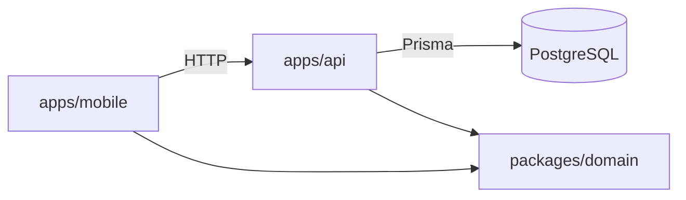

# Gym Tracker

App móvil para registrar entrenamientos de fuerza que **calcula sola la sobrecarga progresiva**:
después de cada sesión te dice con qué peso y cuántas repeticiones ir la próxima vez.

| | |
|---|---|
| **Mobile** | React Native · Expo (SDK 57) · Expo Router · TanStack Query |
| **API** | NestJS · Prisma 7 · PostgreSQL |
| **Dominio** | TypeScript puro, compartido por app y API · Vitest |
| **Infra** | pnpm workspaces · Docker Compose |

## Arquitectura

```
gym-tracker/
├── packages/domain    Modelos de negocio + motor de progresión (sin dependencias de framework)
├── apps/api           API REST: persistencia, validación, orquesta el dominio
└── apps/mobile        App Expo: registra series y muestra el objetivo de la próxima sesión
```



La regla de negocio central vive en `packages/domain` y no conoce ni a Nest ni a React Native.
Así se testea aislada y la usan los dos lados: la API para calcular el objetivo y la app para
mostrar el 1RM estimado y el volumen.

### Modelo de datos

`User` 1─N `Exercise` (con sus reglas de progresión) · `User` 1─N `WorkoutSession` 1─N `ExerciseEntry` 1─N `SetEntry`

## Sobrecarga progresiva (doble progresión)

> Todas las reglas de entrenamiento (onboarding, volumen semanal, feedback por serie) están en [`docs/dominio.md`](docs/dominio.md); cómo se guardan, en [`docs/modelo-datos.md`](docs/modelo-datos.md).

Cada ejercicio tiene series, un rango de repeticiones (ej. 8–12), un incremento de peso y una regla de descarga.
`computeNextTarget()` mira el historial y decide:

| Situación en la última sesión | Decisión | Ejemplo (3×8–12, +2.5 kg) |
|---|---|---|
| Sin historial | `start` | peso inicial × 8 |
| Todas las series al máximo del rango | `increase_weight` | 3×12 @ 40 → **42.5 kg × 8** |
| Dentro del rango | `increase_reps` | 10, 9, 9 @ 40 → **40 kg × 10** |
| Alguna serie bajo el mínimo | `repeat` | 9, 8, 6 @ 40 → **40 kg × 8** |
| N fallos seguidos con el mismo peso | `deload` | 2 fallos @ 60 → **55 kg** (−10%, redondeado a 2.5) |

Las series de calentamiento no cuentan. Los pesos se redondean al incremento (discos disponibles).

### Rango según el tipo de ejercicio

| Tipo | Ejemplos | Por defecto |
|---|---|---|
| **Multiarticular** (`compound`) | sentadilla, press, remo | 3 × 5–8, +2.5 kg |
| **Monoarticular** (`isolation`) | curl, extensiones, elevaciones | 3 × 10–15, +2 kg |

Los multiarticulares son más demandantes (articular y cardiovascularmente), así que van con pocas reps.
Cada ejercicio se puede ajustar a mano (`SCHEME_PRESETS` en `packages/domain`). Pendiente: individualizar
la progresión por usuario (más peso o más series según la persona).

## Rutinas y comparación con la última vez

Una rutina es la plantilla de una sesión ("Empuje", "Pierna"…). Al entrenarla, cada ejercicio muestra el
objetivo de hoy y, serie por serie, lo que hiciste **la última vez que hiciste esa rutina**, con el cambio en vivo
(+2.5 kg, +1 rep, =). `comparePerformance()` decide si progresaste:

| Respecto de la última vez | Resultado |
|---|---|
| Subió el peso máximo | ↑ Progresaste |
| Mismo peso, más reps en total | ↑ Progresaste |
| Mismo peso y mismas reps | = Igual |
| Menos peso, o mismo peso con menos reps | ↓ Por debajo |

Al terminar se muestra un resumen por ejercicio.

## Cómo correrlo

Requisitos: Node 22+, pnpm, Docker y la app **Expo Go** en el celular (misma red Wi-Fi que la PC).

```bash
pnpm install
pnpm build:domain
pnpm db:up                                   # PostgreSQL en Docker
cp apps/api/.env.example apps/api/.env
pnpm --filter @gym/api exec prisma migrate dev
pnpm --filter @gym/api db:generate
pnpm --filter @gym/api db:seed               # usuario demo, ejercicios, 2 rutinas y una sesión pasada
pnpm api                                     # http://localhost:3000
pnpm mobile                                  # escaneá el QR con Expo Go
```

La app encuentra la API sola usando la IP de la PC; para otra URL definí `EXPO_PUBLIC_API_URL`.

```bash
pnpm test        # tests del dominio
pnpm typecheck   # todos los paquetes
```

## API

| Método | Ruta | Descripción |
|---|---|---|
| GET | `/exercises` | Ejercicios del usuario |
| POST | `/exercises` | Crea un ejercicio (valida las reglas con el dominio) |
| GET | `/exercises/:id` | Detalle |
| GET | `/exercises/:id/history` | Sesiones anteriores con sus series |
| GET | `/exercises/:id/next-target` | **Objetivo de la próxima sesión** |
| GET | `/sessions` | Últimas sesiones |
| POST | `/sessions` | Registra una sesión con uno o más ejercicios (opcional `routineId`) |
| GET | `/routines` | Rutinas con sus ejercicios y la fecha de la última vez |
| POST | `/routines` | Crea una rutina (`name`, `exerciseIds` en orden) |
| GET | `/routines/:id/workout` | **Entrenamiento del día**: objetivo + última vez por ejercicio |

## Roadmap

- [ ] Autenticación JWT (el punto de extensión ya está en `CurrentUserId`)
- [x] Rutinas (plantillas de sesión) con comparación contra la última vez
- [ ] Progresión individualizada (subir peso o series según el usuario)
- [ ] Gráficos de progreso (1RM estimado y volumen por semana)
- [ ] Modo offline con cola de sincronización
- [ ] Tests e2e de la API y CI en GitHub Actions
