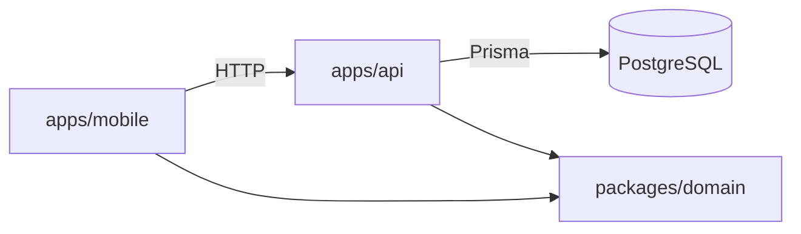

# Gym Tracker

[](https://github.com/mvrtin64/gym-tracker/actions/workflows/ci.yml)

App móvil para registrar entrenamientos de fuerza que **calcula sola la sobrecarga progresiva**:
después de cada sesión te dice con qué peso y cuántas repeticiones ir la próxima vez.

Las reglas de entrenamiento las define un coach (el autor) y están documentadas en
[`docs/dominio.md`](docs/dominio.md): onboarding por nivel, volumen semanal por músculo, rutinas
armadas según los días disponibles, feedback de esfuerzo y de dolor por serie, y ajustes automáticos.

## Qué hace

- **Onboarding por nivel.** Al principiante la app le arma las rutinas (cuerpo completo o
  empuje/tirón/piernas según los días); el intermedio/avanzado elige enfoque, rango y volumen.
- **Entrenamiento del día.** Cada ejercicio muestra el objetivo de hoy y, serie por serie, lo que
  hiciste la última vez, con el cambio en vivo.
- **Sobrecarga progresiva.** Reps dentro del rango y, cuando todas las series llegan al tope, más peso.
- **Feedback que ajusta.** Sensación o RPE por serie, dolor articular y agujetas: la app baja series,
  propone una semana de descarga o sugiere cambiar un ejercicio que duele.
- **La rutina es del usuario.** La app sugiere, pero se pueden cambiar series, quitar, sumar o
  reemplazar ejercicios.

| | |
|---|---|
| **Mobile** | React Native · Expo (SDK 58) · Expo Router · TanStack Query |
| **API** | NestJS · Prisma 7 · PostgreSQL |
| **Dominio** | TypeScript puro, compartido por app y API · Vitest |
| **Infra** | pnpm workspaces · Docker Compose · GitHub Actions |
| **Calidad** | Tests unitarios del dominio (Vitest) · tests de integración de la API contra PostgreSQL (`node:test`) · ESLint |

## Arquitectura

```
gym-tracker/
├── packages/domain    Modelos de negocio + motor de progresión (sin dependencias de framework)
├── apps/api           API REST: persistencia, validación, orquesta el dominio
└── apps/mobile        App Expo: registra series y muestra el objetivo de la próxima sesión
```



La regla de negocio central vive en `packages/domain` y no conoce ni a Nest ni a React Native.
Así se testea aislada y la usan los dos lados: la API para calcular el objetivo y la app para
mostrar el peso de trabajo y el volumen.

### Modelo de datos

`User` 1─N `Exercise` (con sus reglas de progresión) · `User` 1─N `WorkoutSession` 1─N `ExerciseEntry` 1─N `SetEntry`

## Sobrecarga progresiva (doble progresión)

> Todas las reglas de entrenamiento (onboarding, volumen semanal, feedback por serie) están en [`docs/dominio.md`](docs/dominio.md); cómo se guardan, en [`docs/modelo-datos.md`](docs/modelo-datos.md).

Cada ejercicio tiene series, un rango de repeticiones (ej. 8–12), un incremento de peso y una regla de descarga.
`computeNextTarget()` mira el historial y decide:

| Situación en la última sesión | Decisión | Ejemplo (3×8–12, +2.5 kg) |
|---|---|---|
| Sin historial | `start` | peso inicial × 8 |
| Todas las series al máximo del rango | `increase_weight` | 3×12 @ 40 → **42.5 kg × 8** |
| Dentro del rango | `increase_reps` | 10, 9, 9 @ 40 → **40 kg × 10** |
| Alguna serie bajo el mínimo | `repeat` | 9, 8, 6 @ 40 → **40 kg × 8** |
| N fallos seguidos con el mismo peso | `deload` | 2 fallos @ 60 → **55 kg** (−10%, redondeado a 2.5) |

Las series de calentamiento no cuentan. Los pesos se redondean al incremento (discos disponibles).

### Rango según el tipo de ejercicio

| Tipo | Ejemplos | Por defecto |
|---|---|---|
| **Multiarticular** (`compound`) | sentadilla, press, remo | 3 × 5–8, +2.5 kg |
| **Monoarticular** (`isolation`) | curl, extensiones, elevaciones | 3 × 10–15, +2 kg |

Los multiarticulares son más demandantes (articular y cardiovascularmente), así que van con pocas reps.
Cada ejercicio se puede ajustar a mano (`SCHEME_PRESETS` en `packages/domain`). La app nunca suma
series sola: la sobrecarga es subir el peso.

## Rutinas y comparación con la última vez

Una rutina es la plantilla de una sesión ("Empuje", "Pierna"…). Al entrenarla, cada ejercicio muestra el
objetivo de hoy y, serie por serie, lo que hiciste **la última vez que hiciste esa rutina**, con el cambio en vivo
(+2.5 kg, +1 rep, =). `comparePerformance()` decide si progresaste:

| Respecto de la última vez | Resultado |
|---|---|
| Subió el peso máximo | ↑ Progresaste |
| Mismo peso, más reps en total | ↑ Progresaste |
| Mismo peso y mismas reps | = Igual |
| Menos peso, o mismo peso con menos reps | ↓ Por debajo |

Al terminar se muestra un resumen por ejercicio.

## Cómo correrlo

Requisitos: Node 22+, pnpm, Docker y la app **Expo Go** en el celular (misma red Wi-Fi que la PC).

```bash
pnpm install
pnpm build:domain
pnpm db:up                                   # PostgreSQL en Docker
cp apps/api/.env.example apps/api/.env       # completá JWT_SECRET (el archivo explica cómo generarla)
pnpm --filter @gym/api exec prisma migrate dev
pnpm --filter @gym/api db:generate
pnpm --filter @gym/api db:seed               # catálogo de ejercicios, usuario demo con perfil, 2 rutinas y una sesión pasada
pnpm api                                     # http://localhost:3000
pnpm mobile                                  # escaneá el QR con Expo Go
```

La app encuentra la API sola usando la IP de la PC; para otra URL definí `EXPO_PUBLIC_API_URL`.
Para entrar con los datos de ejemplo: **demo@gymtracker.dev** / **demo1234** (o creá una cuenta nueva y pasás por el onboarding).

## Autenticación

- Email y contraseña. La contraseña se guarda con **scrypt** y sal aleatoria (`node:crypto`, sin dependencias nativas).
- La API devuelve un **JWT** (30 días). Un guard global exige `Authorization: Bearer <token>` en todos los
  endpoints salvo los marcados `@Public()` (registro y login); `@CurrentUserId()` toma el usuario del token.
- Login fallido responde lo mismo exista o no el email, y verifica igual un hash de relleno para no
  revelar cuentas por el tiempo de respuesta.
- En la app el token se guarda cifrado con `expo-secure-store` (Keychain / Keystore). Las pantallas están
  protegidas con `Stack.Protected` de Expo Router; si la API responde 401 se cierra la sesión.


## Tests y CI

```bash
pnpm test                          # unitarios: dominio y API
pnpm typecheck                     # todos los paquetes
pnpm lint                          # ESLint de la app
pnpm --filter @gym/api test:e2e    # integración: la API entera contra la base gym_tracker_test
```

Los tests de integración levantan la app de Nest en un puerto libre, aplican las migraciones a una
base aparte y prueban los flujos por HTTP: autenticación, rutinas del principiante, edición de rutinas,
progresión y la sugerencia de nivel. Se compilan con `tsc` y corren con el runner de Node, porque Nest
necesita la metadata de los decoradores. GitHub Actions corre todo en cada PR con un PostgreSQL de servicio.

## API

| Método | Ruta | Descripción |
|---|---|---|
| POST | `/auth/register` | Crea una cuenta (nombre, email, contraseña ≥ 8) y devuelve el token |
| POST | `/auth/login` | Devuelve el token |
| GET | `/auth/me` | Usuario de la sesión |
| GET | `/profile` | Perfil de entrenamiento (respuestas del onboarding) y si se sugiere pasar a intermedio |
| PUT | `/profile` | Guarda el onboarding; la primera vez fija el **volumen inicial** por músculo |
| POST | `/profile/level-up/dismiss` | "Ahora no" a pasar a intermedio (se vuelve a sugerir en un mes) |
| GET | `/volume` | Series semanales objetivo vs. hechas esta semana, por músculo, sugerencias pendientes y descarga |
| PUT | `/volume/:muscle` | Cambio manual del objetivo semanal (queda en el historial) |
| POST | `/volume/changes/:id/accept` · `/dismiss` | Acepta o descarta una sugerencia de volumen |
| POST | `/volume/deload/:id/start` · `/dismiss` | Arranca o descarta una semana de descarga propuesta |
| GET | `/plan` | **Vista previa de la semana**: músculos y series de cada día |
| GET | `/exercises` | Catálogo global + ejercicios propios, con la configuración del usuario |
| POST | `/exercises` | Crea un ejercicio propio (tipo, músculos posibles, enfoque por defecto) |
| GET | `/exercises/:id` | Detalle (incluye demo y tip del coach) |
| PUT | `/exercises/:id/settings` | Anotación del usuario (ej. *"banco a 30°"*) e incremento de peso |
| GET | `/exercises/:id/history` | Sesiones anteriores con sus series |
| GET | `/sessions` | Últimas sesiones |
| POST | `/sessions` | Registra una sesión (sensación o RPE → RIR por serie) con dolor articular y agujetas, y devuelve los **ajustes**: bajar series, apretar más, semana de descarga, bajar peso o cambiar un ejercicio que duele |
| GET | `/routines` | Rutinas con su prescripción y la fecha de la última vez |
| POST | `/routines` | Crea una rutina: ejercicios en orden, enfoque, series y rango |
| GET | `/routines/:id/workout` | **Entrenamiento del día**: objetivo, anotación y última vez por ejercicio (reducido si hay descarga; con menos peso si duele) |
| POST | `/routines/generate` | **Arma las rutinas de la semana**: al principiante, sus días base; al resto, desde el plan, 1 a 3 ejercicios por músculo, multiarticulares primero |
| POST | `/routines/:id/exercises` | Suma un ejercicio a la rutina |
| GET | `/routines/:id/exercises/:exerciseId/alternatives` | Ejercicios del mismo músculo para cambiar uno |
| POST | `/routines/:id/exercises/:exerciseId/replace` | Cambia un ejercicio de la rutina por otro del mismo músculo (ej. porque duele) |
| PATCH | `/routines/:id/exercises/:exerciseId` | Cambia las series de un ejercicio en la rutina (1–10) |
| DELETE | `/routines/:id/exercises/:exerciseId` | Quita un ejercicio de la rutina (tiene que quedar al menos uno) |

## Roadmap

- [x] Autenticación con email y contraseña (JWT)
- [ ] Login con Google y recuperación de contraseña
- [x] Rutinas (plantillas de sesión) con comparación contra la última vez
- [x] Gráfico de progreso: peso de trabajo por ejercicio, sesión a sesión
- [ ] Modo offline con cola de sincronización
- [x] Tests de integración de la API y CI en GitHub Actions
- [ ] Capturas de pantalla en este README
- [ ] Publicación en Play Store
