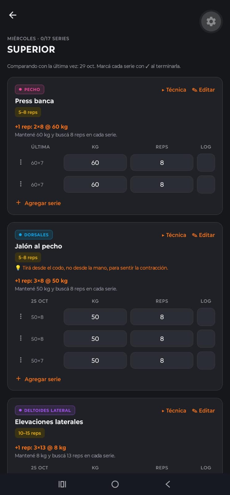
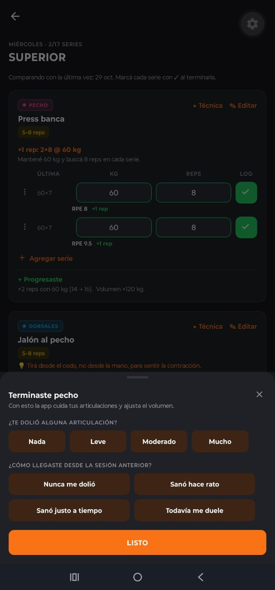
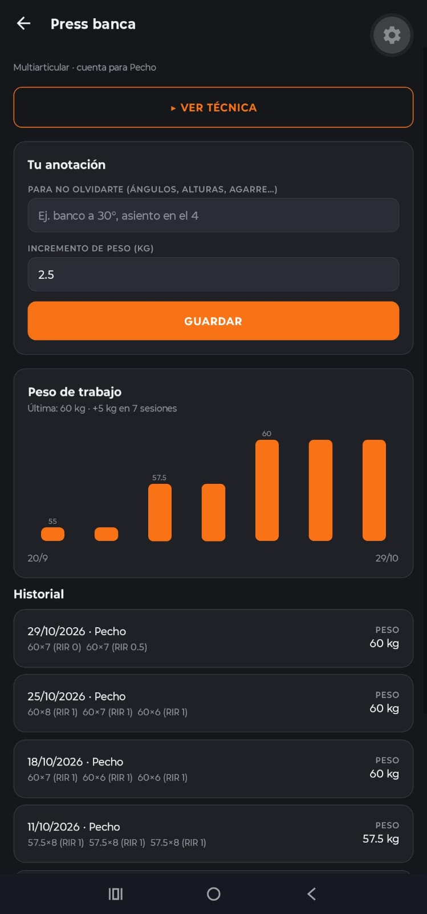
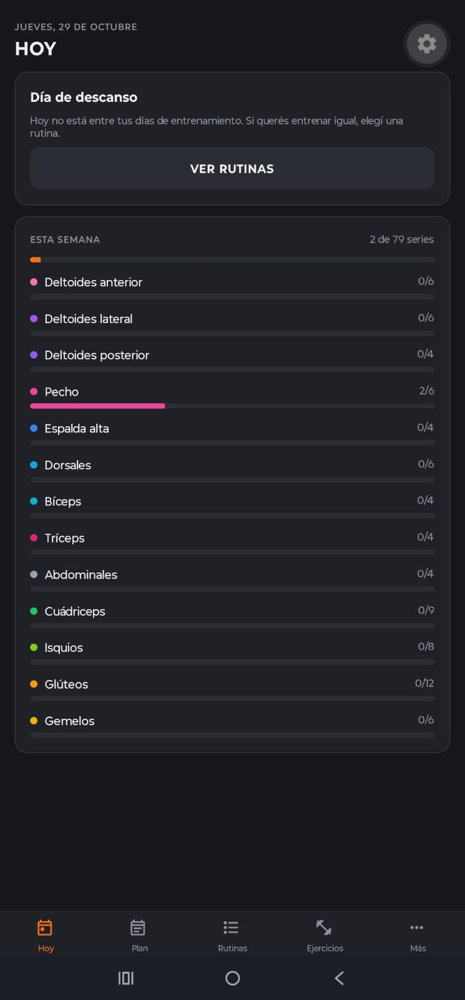
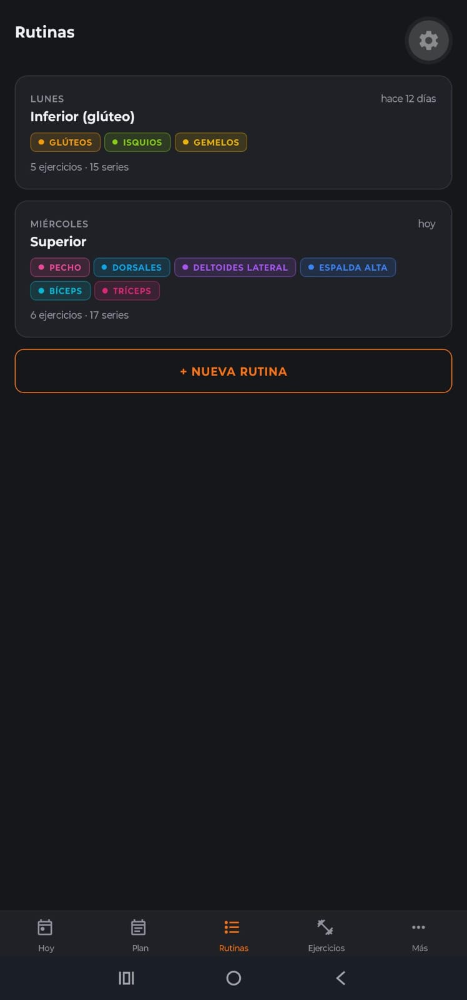
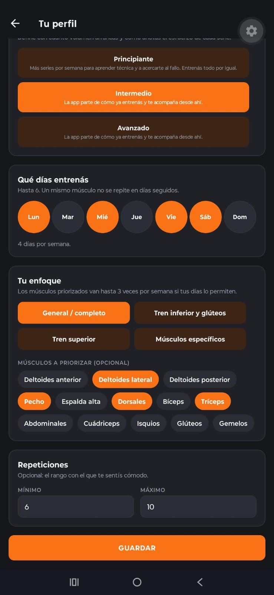
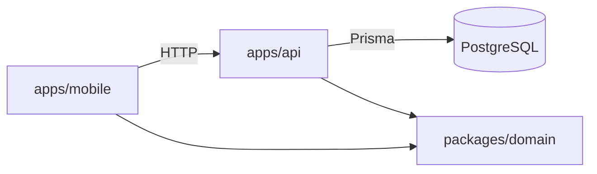

# Gym Tracker

[](https://github.com/mvrtin64/gym-tracker/actions/workflows/ci.yml)

A strength training mobile app that **handles progressive overload for you**: after every session it
tells you what weight and how many reps to do next time.

The training rules are defined by a gym coach (the author) and documented in
[`docs/dominio.md`](docs/dominio.md) (in Spanish): level-based onboarding, weekly volume per muscle,
routines built around the days you can train, effort and joint-pain feedback per set, and automatic
adjustments. The app itself is in Spanish.

<table>
  <tr>
    <td></td>
    <td></td>
    <td></td>
  </tr>
  <tr>
    <td align="center">Today's workout</td>
    <td align="center">Post-exercise feedback</td>
    <td align="center">Progress per exercise</td>
  </tr>
  <tr>
    <td></td>
    <td></td>
    <td></td>
  </tr>
  <tr>
    <td align="center">Today and weekly volume</td>
    <td align="center">Routines</td>
    <td align="center">Profile</td>
  </tr>
</table>

## Features

- **Level-based onboarding.** Beginners get their routines built for them (full body or
  push/pull/legs depending on the days); intermediate and advanced lifters choose their focus, rep
  range and volume.
- **Today's workout.** Every exercise shows today's target and, set by set, what you did last time,
  with the difference updated live.
- **Progressive overload.** Add reps within the range and, once every set hits the top, add weight.
- **Feedback that adjusts the plan.** Feel or RPE per set, joint pain and soreness: the app reduces
  sets, proposes a deload week or suggests swapping an exercise that hurts.
- **Progress and technique.** A chart of each exercise's working weight, session by session, and a
  short technique video picked by the coach for every exercise in the catalog.
- **Users own their routine.** The app suggests, but sets can be changed and exercises removed,
  added or replaced.

| | |
|---|---|
| **Mobile** | React Native · Expo (SDK 58) · Expo Router · TanStack Query |
| **API** | NestJS · Prisma 7 · PostgreSQL |
| **Domain** | Plain TypeScript, shared by the app and the API · Vitest |
| **Infra** | pnpm workspaces · Docker Compose · GitHub Actions |
| **Quality** | Domain unit tests (Vitest) · API integration tests against PostgreSQL (`node:test`) · ESLint |

## Architecture

```
gym-tracker/
├── packages/domain    Business models + progression engine (no framework dependencies)
├── apps/api           REST API: persistence, validation, orchestrates the domain
└── apps/mobile        Expo app: logs sets and shows the next session's target
```



The core business rules live in `packages/domain`, which knows nothing about Nest or React Native.
That keeps them testable in isolation and shared by both sides: the API uses them to compute targets
and the app to show working weight and volume.

### Data model

`User` 1─N `Exercise` (with its progression settings) · `User` 1─N `WorkoutSession` 1─N `ExerciseEntry` 1─N `SetEntry`

## Progressive overload (double progression)

> All training rules (onboarding, weekly volume, per-set feedback) are in [`docs/dominio.md`](docs/dominio.md); how they are stored, in [`docs/modelo-datos.md`](docs/modelo-datos.md) (both in Spanish).

Each exercise has a number of sets, a rep range (e.g. 5–8), a weight increment and a deload rule.
`computeNextTarget()` looks at the history and decides:

| Last session | Decision | Example (3×5–8, +2.5 kg) |
|---|---|---|
| No history | `start` | starting weight × 5 |
| Every set at the top of the range | `increase_weight` | 3×8 @ 40 → **42.5 kg × 5** |
| Within the range | `increase_reps` | 7, 6, 6 @ 40 → **40 kg × 7** |
| A set below the minimum | `repeat` | 6, 5, 4 @ 40 → **40 kg × 5** |
| N misses in a row at the same weight | `deload` | 2 misses @ 60 → **55 kg** (−10%, rounded to 2.5) |

Warm-up sets don't count. Weights are rounded to the increment (available plates).

### Rep range by exercise type

| Type | Examples | Default |
|---|---|---|
| **Compound** | squat, press, row | 3 × 5–8, +2.5 kg |
| **Isolation** | curl, extensions, raises | 3 × 10–15, +2 kg |

Compound lifts are more demanding (on the joints and the cardiovascular system), so they stay in a
lower rep range. Every exercise can be adjusted by hand (`SCHEME_PRESETS` in `packages/domain`). The
app never adds sets on its own: overload means adding weight.

## Routines and comparing with last time

A routine is a session template ("Push", "Legs"…). While training it, every exercise shows today's
target and, set by set, what you did **the last time you did that routine**, with the live difference
(+2.5 kg, +1 rep, =). `comparePerformance()` decides whether you progressed:

| Compared with last time | Result |
|---|---|
| Higher top weight | ↑ Progressed |
| Same weight, more total reps | ↑ Progressed |
| Same weight and same reps | = Same |
| Less weight, or same weight with fewer reps | ↓ Below |

A per-exercise summary is shown at the end.

## Running it

Requirements: Node 22+, pnpm, Docker and the **Expo Go** app on your phone (on the same Wi-Fi network as
your computer).

```bash
pnpm install
pnpm build:domain
pnpm db:up                                   # PostgreSQL in Docker
cp apps/api/.env.example apps/api/.env       # fill in JWT_SECRET (the file explains how to generate it)
pnpm --filter @gym/api exec prisma migrate dev
pnpm --filter @gym/api db:generate
pnpm --filter @gym/api db:seed               # exercise catalog, demo user with profile, 2 routines and 6 weeks of history
pnpm api                                     # http://localhost:3000
pnpm mobile                                  # scan the QR code with Expo Go
```

The app finds the API on its own using your computer's IP; set `EXPO_PUBLIC_API_URL` to use another URL.
To log in with the sample data: **demo@gymtracker.dev** / **demo1234** (or create a new account and go
through onboarding).

## Authentication

- Email and password. Passwords are stored with **scrypt** and a random salt (`node:crypto`, no native
  dependencies).
- The API returns a **JWT** (30 days). A global guard requires `Authorization: Bearer <token>` on every
  endpoint except those marked `@Public()` (register and login); `@CurrentUserId()` reads the user from
  the token.
- A failed login gives the same response whether or not the email exists, and still checks a dummy hash
  so response times don't reveal which accounts exist.
- In the app the token is stored encrypted with `expo-secure-store` (Keychain / Keystore). Screens are
  protected with Expo Router's `Stack.Protected`; a 401 from the API signs the user out.

## Tests and CI

```bash
pnpm test                          # unit tests: domain and API
pnpm typecheck                     # every package
pnpm lint                          # ESLint for the app
pnpm --filter @gym/api test:e2e    # integration: the whole API against the gym_tracker_test database
```

The integration tests start the Nest app on a free port, apply the migrations to a separate database
and exercise the flows over HTTP: authentication, beginner routines, routine editing, progression and
the level-up suggestion. They are compiled with `tsc` and run with Node's test runner, because Nest
needs decorator metadata. GitHub Actions runs everything on every PR against a PostgreSQL service.

## API

| Method | Route | Description |
|---|---|---|
| POST | `/auth/register` | Creates an account (name, email, password ≥ 8) and returns the token |
| POST | `/auth/login` | Returns the token |
| GET | `/auth/me` | The signed-in user |
| GET | `/profile` | Training profile (onboarding answers) and whether moving to intermediate is suggested |
| PUT | `/profile` | Saves onboarding; the first time it sets the **starting volume** per muscle |
| POST | `/profile/level-up/dismiss` | "Not now" to moving to intermediate (suggested again in a month) |
| GET | `/volume` | Target vs. completed weekly sets per muscle, pending suggestions and deload |
| PUT | `/volume/:muscle` | Manually changes the weekly target (kept in the history) |
| POST | `/volume/changes/:id/accept` · `/dismiss` | Accepts or dismisses a volume suggestion |
| POST | `/volume/deload/:id/start` · `/dismiss` | Starts or dismisses a proposed deload week |
| GET | `/plan` | **Week preview**: muscles and sets for each day |
| GET | `/exercises` | Global catalog + the user's own exercises, with the user's settings |
| POST | `/exercises` | Creates a custom exercise (type, possible muscles, default focus) |
| GET | `/exercises/:id` | Detail (includes the technique video and the coach's tip) |
| PUT | `/exercises/:id/settings` | The user's note (e.g. *"bench at 30°"*) and weight increment |
| GET | `/exercises/:id/history` | Previous sessions with their sets |
| GET | `/sessions` | Latest sessions |
| POST | `/sessions` | Logs a session (feel or RPE → RIR per set) with joint pain and soreness, and returns the **adjustments**: fewer sets, push harder, deload week, lower the weight or swap an exercise that hurts |
| GET | `/routines` | Routines with their prescription and the date of the last session |
| POST | `/routines` | Creates a routine: ordered exercises, focus, sets and range |
| GET | `/routines/:id/workout` | **Today's workout**: target, note and last time for each exercise (reduced during a deload; lighter if it hurts) |
| POST | `/routines/generate` | **Builds the week's routines**: beginners get their base days; everyone else gets them from the plan, 1 to 3 exercises per muscle, compounds first |
| POST | `/routines/:id/exercises` | Adds an exercise to the routine |
| GET | `/routines/:id/exercises/:exerciseId/alternatives` | Exercises for the same muscle, to swap one |
| POST | `/routines/:id/exercises/:exerciseId/replace` | Swaps an exercise in the routine for another one for the same muscle (e.g. because it hurts) |
| PATCH | `/routines/:id/exercises/:exerciseId` | Changes an exercise's sets in the routine (1–10) |
| DELETE | `/routines/:id/exercises/:exerciseId` | Removes an exercise from the routine (at least one must remain) |

## Roadmap

- [x] Email and password authentication (JWT)
- [ ] Google sign-in and password recovery
- [x] Routines (session templates) compared against last time
- [x] Progress chart: working weight per exercise, session by session
- [ ] Offline mode with a sync queue
- [x] API integration tests and CI on GitHub Actions
- [x] Screenshots in this README
- [ ] Hosted API, so the app works away from the local network
- [ ] Private Android build (APK) to share with the people I coach
