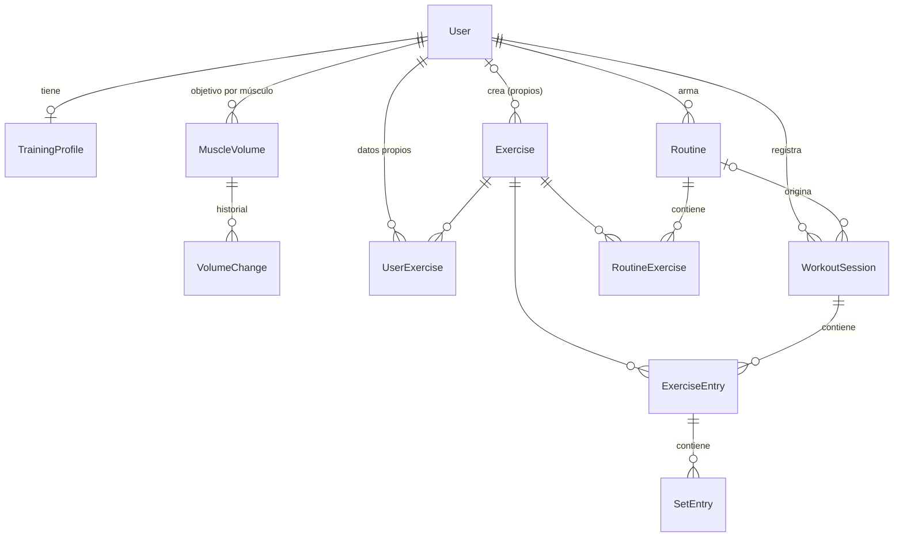

# Modelo de datos

Cómo se guardan las reglas de [`dominio.md`](dominio.md). Estado: **propuesto**, falta implementar.

## Entidades

### Perfil y volumen

| Entidad | Campos clave | Notas |
|---|---|---|
| `TrainingProfile` | `level`, `trainingDays` (lun…dom), `focus`, `priorityMuscles`, `preferredRepMin/Max` | 1:1 con `User`. El principiante no tiene enfoque ni prioridades (§2) |
| `MuscleVolume` | `muscle`, `weeklySets` | Valor **actual** del objetivo semanal por músculo |
| `VolumeChange` | `muscle`, `delta`, `reason`, `status` (`suggested` · `applied` · `dismissed`), `createdAt` | Historial: permite explicar *por qué* cambió. En rutinas propias queda `suggested` hasta que el usuario acepta |

### Ejercicios

| Entidad | Campos clave | Notas |
|---|---|---|
| `Exercise` | `name`, `type` (`compound` · `isolation`), `targetMuscles[]`, `defaultTarget`, `demoUrl`, `coachTip`, `ownerId?` | Catálogo **global**. Con `ownerId` es un ejercicio propio, visible solo para ese usuario. `demoUrl`: GIF o link de YouTube |
| `UserExercise` | `note`, `weightIncrementKg`, `startingWeightKg`, `deloadFactor`, `failuresBeforeDeload` | Lo del usuario sobre un ejercicio (ej. *"banco a 30°"*). Único por usuario + ejercicio |

### Rutinas

| Entidad | Campos clave | Notas |
|---|---|---|
| `Routine` | `name`, `origin` (`manual` · `generated`), `adjustMode` (`suggest` · `auto`), `weekday?` | `adjustMode` por defecto según `origin`; el usuario lo puede cambiar |
| `RoutineExercise` | `position`, `targetMuscle`, `sets`, `repMin`, `repMax` | La **prescripción** vive acá, no en el ejercicio: la misma búlgara puede ir con enfoque glúteo en una rutina y cuádriceps en otra |

### Registro

| Entidad | Campos clave | Notas |
|---|---|---|
| `WorkoutSession` | `performedAt`, `routineId?`, `isDeload`, `notes` | `isDeload`: semana de descarga (§5.3) |
| `ExerciseEntry` | `position`, `targetMuscle` | `targetMuscle` se **copia** al anotar: si la rutina cambia, el volumen histórico no se recalcula mal |
| `SetEntry` | `weightKg`, `reps`, `warmup`, `feel?`, `rpe?`, `rir` | Se guarda lo que respondió el usuario (`feel` el principiante, `rpe` el resto) **y** el `rir` calculado |

## Enums

- `Muscle`: `front_delt` · `side_delt` · `rear_delt` · `chest` · `upper_back` · `lats` · `biceps` ·
  `triceps` · `abs` · `quads` · `hamstrings` · `glutes` · `calves`
- `Level`: `beginner` · `intermediate` · `advanced`
- `Focus`: `general` · `lower` · `upper` · `specific`
- `Feel`: `failure` (RIR 0) · `one_two_left` (1–2) · `several_left` (3–4) · `very_easy` (5+)

## Código de dominio (`packages/domain`)

Funciones puras, sin framework, con tests:

| Módulo | Responsabilidad |
|---|---|
| `rir` | Sensación / RPE → RIR |
| `volume` | Series efectivas semanales por músculo; volumen inicial según perfil |
| `adjustment` | Estancamiento por músculo y general; semana de descarga y vuelta gradual |
| `planning` | Reparto por días: frecuencia, descanso entre días, series por ejercicio |
| `progression` | Doble progresión (ya existe) |
